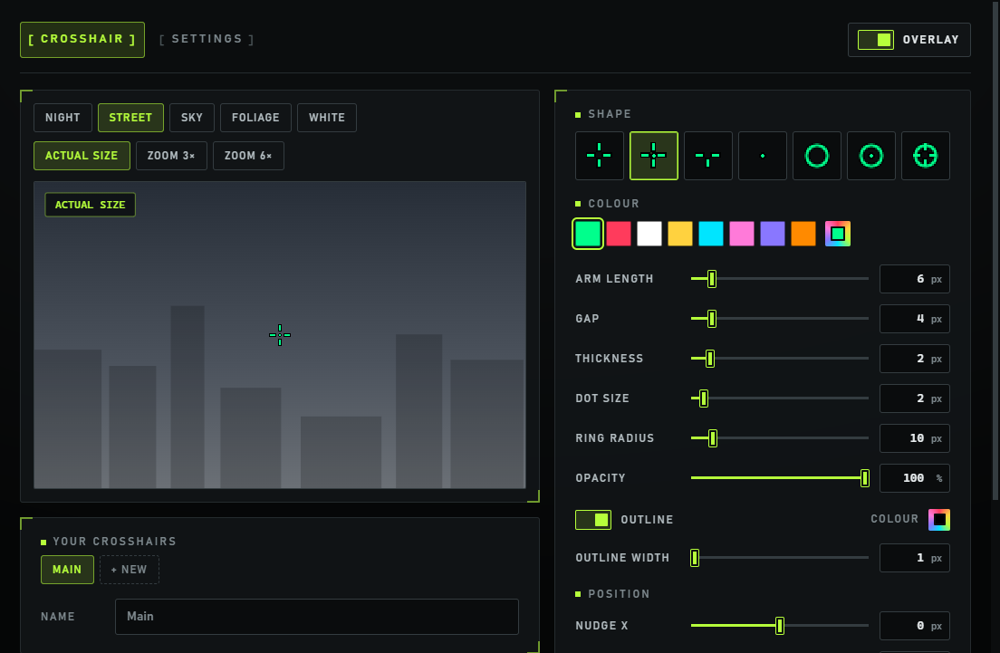

# SmartXair

A free Windows crosshair overlay for games running in borderless or windowed mode. It follows the focused game and can hide when its cursor appears. **The Division 2** includes built-in compatibility rules.

## Download

1. Download the Windows x64 ZIP from [GitHub Releases](https://github.com/mikeymain/smartxair/releases).
2. Extract the entire ZIP, then open `SmartXair.exe` from the extracted folder. Windows may show a SmartScreen warning because the beta is unsigned.

On first launch, SmartXair copies any existing settings from the former SmartReticle app.

## Set up a game

1. Start the game in **Borderless** or **Windowed** mode. SmartXair's external overlay requires one of these modes.
2. If the game isn't detected, open **Settings → Games** and pick it from the running games list or enter its executable name. Windowed games need to be added. New setups automatically detect borderless games that fill a monitor. If you upgraded with auto-detection off, turn on **Auto-detect fullscreen games** to use it.
3. Press **F8** to toggle the overlay. If the game keeps its cursor visible during play, turn off **Hide while the mouse cursor is visible**.

### The Division 2

1. In the game's video settings, set the window mode to **Windowed** at your monitor's resolution.
2. Leave **Force borderless** on in the Settings tab. SmartXair removes the window frame and stretches the game over the monitor. The overlay requires windowed or borderless mode.
3. Play. The crosshair hides when you alt-tab, minimise the game, or open a menu that shows the mouse cursor. `F8` toggles it at any time, and the key still reaches the game.

If the debug log says `Borderless: FAILED`, first check that the game is in Windowed mode and both apps are running normally. If you run the game as administrator, SmartXair needs the same elevation to change its window style.

## Tabs

- **Crosshair**: 7 shapes, colour, size, gap, thickness, outline, opacity and a pixel nudge. The live preview has game-like backdrops at actual size, 3× and 6× zoom. Save several crosshairs as profiles, start from presets, and copy or paste share codes (`SR2-…`; old `SR1-…` codes also load).
- **Settings**: game detection, the game list, and the rules:
  - Force borderless and Require mouse lock apply to The Division 2 by default. To use them for other games, add those games and enable **Extend compatibility to all listed games**. Existing custom game lists keep their previous compatibility behavior.
  - Hide while the mouse cursor is visible
  - Hide when the game draws its own cursor (experimental, off by default)
  - Auto-detect fullscreen games
  - Aim mode (`Always`, `Hide while aiming`, `Only while aiming`), with a configurable aim key
  - Show delay
  - On/off hotkey, Launch with Windows (packaged build only), and Start in the tray
Closing the window leaves the overlay running from the tray. Use the tray menu to quit.

To remove the portable app, turn off **Launch with Windows** if you enabled it, quit from the tray, then delete the extracted folder.

## Safety

SmartXair uses only public Windows calls:
- the focused window and its process name (from a process snapshot, never `OpenProcess`)
- the cursor state and clip rectangle
- key state
- window-style changes for force-borderless

It never injects into or reads the game's memory. Check the game's rules anyway.

## Development

Run `npm ci`, then `npm start` on Windows. If npm's install-script blocker skips Electron's download, run `node node_modules/electron/install.js` once.

| Path | What |
|---|---|
| `main.cjs` | Windows, tray, the detection loop (60 Hz while the game is focused, 20 Hz otherwise), IPC. The settings window is created when opened and destroyed when closed. |
| `engine/` | `win32.cjs` (koffi bindings), `detector.cjs`, `borderless.cjs`, `logic.cjs` (pure rules), `settings.cjs`, `log.cjs` |
| `renderer/` | Settings UI (`index.html`, `app.js`, `ui-controls.js`, `styles.css`), click-through overlay (`overlay.html/js`), and `crosshair-draw.js`, which both share |
| `test/` | `npm test`: engine, settings, drawing, runtime and packaging regressions with `node --test` |
| `scripts/snapshot.cjs` | `npm run snapshot`: screenshots every tab |
| `prototype-csharp/` | The first native version. Its `bin\CursorLab.exe game\|menu\|softmenu\|rawgame\|windowed` fakes each game state for testing. |

`npm run package` builds `dist\SmartXair-win32-x64`.

## License

[MIT](LICENSE)
